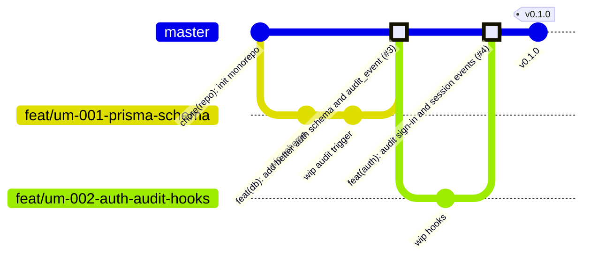
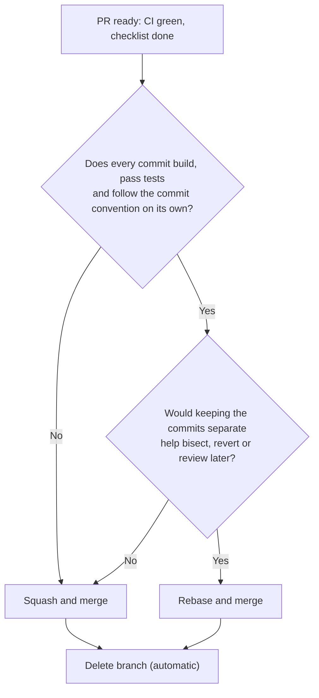

# REDOVA — Git Strategy

| Item | Value |
| --- | --- |
| Applies to | The whole REDOVA monorepo (all apps, packages and docs) |
| Model | GitHub Flow (trunk-based): `master` is the only long-lived branch; one short-lived branch per change |
| Commit convention | Conventional Commits 1.0.0 |
| Default merge method | **Squash and merge** |
| Enforcement | Commit-msg hook + CI `git-hygiene` job + `master` branch protection (set up in [UM-001](user-management/tickets/UM-001-auth-foundation.md)) |

---

## 1. Principles

1. **`master` is always green and releasable.** Nothing reaches `master` without a pull request and passing CI.
2. **Small, short-lived branches.** A branch lives hours to a few days, not weeks. Large tickets are delivered as several PRs.
3. **One PR = one logical change = one commit on `master`** (by default, through squash and merge).
4. **History is linear.** No merge commits on `master`. `git log --oneline master` reads like a changelog.
5. **Every change is traceable.** Branch, commits and PR all reference the ticket (`UM-xxx`) and its GitHub issue.
6. **No AI attribution in history.** Commits and PRs must **never** contain `Co-authored-by:` trailers or "Generated with/by Claude" (or any other AI tool) attribution. See §4.5.
7. **No secrets in Git, ever** (§11).

---

## 2. Branching model



*(The diagram shows each branch landing on `master` as a **single squashed commit**. Git graphs draw it as a merge, but `master` stays linear, see §6.)*

| Branch | Lifetime | Created from | Merged into | Notes |
| --- | --- | --- | --- | --- |
| `master` | permanent | — | — | Protected (§8). Tagged at each sprint end. |
| `<type>/um-<nnn>-<description>` | short (≤ 3 days ideally) | `master` | `master` via PR | All feature, fix, test, docs and chore work. |
| `spike/um-<nnn>-<description>` | timeboxed | `master` | **never merged** | Throw-away experiments. Findings are written into the ticket, then the branch is deleted. |
| `hotfix/um-<nnn>-<description>` | hours | latest release tag or `master` | `master` via PR | Urgent fix of a released version (§10). |

There is **no `develop` branch and no GitFlow.** With one developer and continuous integration on `master`, a second integration branch would add merges and drift without any benefit.

---

## 3. Branch naming

### 3.1 Format

```text
<type>/um-<nnn>-<short-description>
```

- `type`: one of the types in §3.2.
- `um-<nnn>`: ticket id, **lowercase**, zero-padded (`um-001`). Lowercase avoids case conflicts on Windows/macOS file systems and in remote refs.
- `short-description`: 2–5 words, kebab-case, lowercase ASCII, digits allowed, max 40 characters.
- Work without a ticket (rare: repository maintenance) uses `<type>/<short-description>`, e.g. `chore/update-pnpm`.

Validation regex (used by the CI `git-hygiene` job):

```text
^(feat|fix|refactor|perf|test|docs|build|ci|chore|spike|hotfix)/(um-[0-9]{3}-)?[a-z0-9]+(-[a-z0-9]+)*$
```

### 3.2 Types

| Type | Use for |
| --- | --- |
| `feat` | New behavior (endpoint, plugin configuration, hook, policy) |
| `fix` | Bug fix |
| `refactor` | Code change without behavior change |
| `perf` | Performance improvement |
| `test` | Adding or fixing tests only |
| `docs` | Documentation only |
| `build` | Build system, dependencies, Docker images |
| `ci` | CI workflows |
| `chore` | Repository maintenance that fits nowhere else |
| `spike` | Timeboxed experiment, never merged |
| `hotfix` | Urgent production fix (§10) |

### 3.3 Examples

| Good | Bad | Why bad |
| --- | --- | --- |
| `feat/um-001-monorepo-migration` | `feature/UM-001` | Wrong type, uppercase, no description |
| `feat/um-001-prisma-schema` | `um-001-prisma` | Missing type |
| `feat/um-006-org-escalation-hooks` | `feat/um-006-implement-all-the-rbac-and-tenant-isolation-stuff` | Too long, vague |
| `fix/um-004-backup-code-reuse` | `fix/bug` | No ticket, no meaning |
| `spike/um-001-esm-prisma7` | `test-branch` | No type/ticket |

### 3.4 Splitting a ticket into branches

Tickets of 5 SP or more are delivered as **several PRs**, one per coherent slice, each leaving `master` green. Example for UM-001:

1. `spike/um-001-esm-prisma7` (not merged; results go into the ticket)
2. `chore/um-001-monorepo-migration`
3. `build/um-001-local-infrastructure`
4. `feat/um-001-contracts-and-db`
5. `feat/um-001-better-auth-config`
6. `feat/um-001-nest-integration`
7. `ci/um-001-pipeline-and-git-hygiene`

---

## 4. Commit messages

### 4.1 Format (Conventional Commits 1.0.0)

```text
<type>(<scope>): <subject>

<body: why the change was made, what was wrong before; wrap at 72 chars>

Refs: UM-001
BREAKING CHANGE: <description, only when applicable>
```

### 4.2 Rules

| Element | Rule |
| --- | --- |
| `type` | Same list as branch types (§3.2) except `spike` and `hotfix` (a hotfix commit uses `fix`). |
| `scope` | Required. One of: `server`, `worker`, `web`, `auth`, `contracts`, `core`, `db`, `integrations`, `queue`, `infra`, `ci`, `docs`, `deps`, `repo`. |
| `subject` | Imperative mood ("add", not "added"/"adds"), lowercase first letter, no trailing period, ≤ 72 characters including type and scope. |
| `body` | Optional for trivial changes. Explains **why**, not how. Wrapped at 72 characters. |
| Footer `Refs:` | Required when a ticket exists: `Refs: UM-001`. |
| Breaking change | `!` after the scope (`feat(contracts)!: …`) **and** a `BREAKING CHANGE:` footer. |
| Language | English. |

### 4.3 Examples

```text
feat(auth): enable organization plugin with redova roles

Configure the organization plugin with the six REDOVA roles and
ORG_OWNER as creator role so that native owner protections apply.

Refs: UM-001
```

```text
fix(auth): reject role changes without explicit organization id

The before-hook and Better Auth could resolve different organizations
when the body relied on the session's active organization.

Refs: UM-006
```

```text
test(server): cover cross-tenant cursor reuse on audit events

Refs: UM-008
```

### 4.4 Commits on a feature branch

On a branch that will be **squashed**, intermediate commits may be informal (`wip`, `fix tests`). They disappear on merge. On a branch that will be **rebased and merged** (§6.2), **every** commit must follow §4.1–§4.2 and pass CI on its own.

### 4.5 Forbidden content (commits and PRs)

The following must **never** appear in a commit message, a PR title or a PR description:

| Forbidden | Example |
| --- | --- |
| Any `Co-authored-by:` trailer | `Co-Authored-By: Claude <noreply@anthropic.com>` |
| Any "generated by/with" AI attribution | `🤖 Generated with Claude Code`, `Generated by Claude` |
| Links or signatures attributing work to an AI tool | `https://claude.com/claude-code` |

Notes:

- **GitHub adds `Co-authored-by:` trailers automatically** on squash merges when the branch contains commits from more than one author identity. Always commit with the same identity (`git config user.name` / `user.email`) so that squash commits stay clean.
- If a forbidden trailer slips into a commit on your branch, remove it with `git commit --amend` (last commit) or `git rebase -i origin/master` (older commits) **before** merging. Never rewrite `master`.

Detection pattern (case-insensitive) used by the hook and CI:

```text
co-authored-by:|generated (with|by) .*claude|claude\.com/claude-code|🤖
```

---

## 5. Pull requests

### 5.1 When to open

- Open a **draft PR** as soon as the branch is pushed. CI then runs early.
- Mark it **Ready for review** when the PR's scope is complete, CI is green, and the self-review checklist is done.

### 5.2 Title

The PR title becomes the squash commit subject, so it **must** follow the commit format (§4.1), without the footer:

```text
feat(auth): enable organization plugin with redova roles
```

GitHub appends ` (#<PR number>)` on squash, which links `master`'s history back to the PR.

### 5.3 Size

| Changed lines (excluding lockfile, generated Prisma client, migration SQL, snapshots) | Rule |
| --- | --- |
| ≤ 400 | Target |
| 401–800 | Allowed. Explain in **Context** why it can't be split. |
| > 800 | Split the PR (§3.4). |

### 5.4 Description template

Stored as `.github/pull_request_template.md` (created in UM-001). GitHub pre-fills every new PR with it. All sections are mandatory, and sections that don't apply say "N/A" with a reason.

```markdown
## Summary
Briefly explain the purpose of this pull request.

## Context
Describe the problem, requirement, or motivation behind the change.

## Changes
- Implemented ...
- Updated ...
- Removed ...

## Testing
- [ ] Unit tests passed
- [ ] Integration tests passed
- [ ] Lint and type checks passed
- [ ] Relevant security checks passed

**Validation evidence:**
Describe test commands, results, or CI run links.

## Related Issues
Refs #ISSUE_NUMBER

## Checklist
- [ ] Changes are scoped and self-reviewed
- [ ] Tests have been added or updated
- [ ] Documentation is updated if necessary
- [ ] No secrets or sensitive data are committed
- [ ] CI pipeline passes
```

Filling rules:

- **Summary:** one or two sentences. Mention the ticket (`UM-006`).
- **Context:** link the ticket file and the README section (e.g. `docs/user-management/tickets/UM-006-rbac-multitenancy.md`, README §10.4).
- **Changes:** one bullet per notable change, using the verbs shown (Implemented / Updated / Removed / Added / Fixed).
- **Testing:** tick only what actually ran. **Validation evidence** lists the exact commands (`pnpm turbo run test --filter @redova/server`), the result (e.g. "142 passed") and the CI run link. List the acceptance criteria covered (e.g. "AC-006-01 … AC-006-07").
- **Related Issues:** use `Refs #N` for intermediate PRs of a ticket, and `Closes #N` on the **last** PR that completes the ticket, so the issue closes automatically.
- **Checklist:** every box must be ticked before merging.

### 5.5 Review (solo development)

GitHub does not allow authors to approve their own PRs, so `master` requires **0 approvals**. Status checks and the self-review are mandatory instead:

1. Read the full diff in the GitHub UI (not only in the editor).
2. Re-check the ticket's acceptance criteria and the security checklist (README §17.2) for the touched area.
3. Confirm the PR title, the description and every commit message are free of forbidden content (§4.5).
4. For PRs touching **authentication, authorization or tenant isolation** (UM-001, UM-004, UM-006, UM-007), request a review from the PFE supervisor when available. The supervisor's comments must be resolved before merge.

### 5.6 Linking tickets and issues

- One GitHub issue per ticket, titled exactly like the ticket: `UM-006 — RBAC & Multi-Tenant Authorization`, with labels `user-management` and `P0`/`P1`.
- Branch name, commit footers and PR description all reference the ticket.

---

## 6. Integration strategies: squash, rebase or merge

### 6.1 Decision table

| Strategy | Where | Use when | Never when |
| --- | --- | --- | --- |
| **Squash and merge** *(default)* | PR → `master` | Almost always: the branch contains WIP, fixup or review-response commits, or the PR is one logical change. | — |
| **Rebase and merge** | PR → `master` | The PR contains **2–5 curated commits**, **each** a self-contained, conventional, CI-passing step, and keeping them separate helps `git bisect`/`git revert` (e.g. `refactor(db): extract repository` then `feat(server): add admin users endpoint`). | Any commit is WIP, fails tests on its own, or has a non-conventional message. |
| **Rebase** (local) | Your feature branch onto `origin/master` | Updating your **own** branch with the latest `master`, or cleaning commits before a rebase-and-merge (`git rebase -i`). Push with `--force-with-lease`. | The branch is shared with another person, or the commits are already on `master`. |
| **Merge commit** | Into a **shared** feature branch only | Bringing `master` into a branch that **someone else also pushes to** (rewriting their history would break their clone). | Into `master`: merge commits are **disabled** there (linear history, §8). |

### 6.2 Decision flow for merging a PR



### 6.3 Squash-and-merge procedure

1. Ensure the PR title follows §4.1 (it becomes the commit subject).
2. In GitHub's squash dialog, replace the default body with `Refs: UM-xxx` and an optional 1–3 line "why". Delete the list of WIP commit messages that GitHub pre-fills.
3. Check there is **no** `Co-authored-by:` line in the dialog (§4.5), then confirm.

### 6.4 Keeping a branch up to date

```bash
git fetch origin
git rebase origin/master                 # resolve conflicts, then: git rebase --continue
pnpm turbo run lint typecheck test     # re-verify after the rebase
git push --force-with-lease            # never plain --force
```

- Rebase at least daily on long-running work, and always before marking the PR ready.
- If a rebase gets messy (repeated conflicts in the same files), abort it (`git rebase --abort`), squash locally first (`git reset --soft origin/master && git commit`), then rebase.
- If the branch is shared: `git merge origin/master` instead (§6.1, merge commit row).

### 6.5 Conflict resolution rules

- Resolve conflicts in **your** branch, never on `master`.
- For `pnpm-lock.yaml`: take `master`'s version, then run `pnpm install` to regenerate it. Never hand-merge the lockfile.
- For Prisma migrations: never edit a migration that is already on `master`. If two branches created migrations, rebase and **regenerate** yours on top of `master`'s.
- Re-run the full test suite after any conflict resolution.

---

## 7. Working cycle (cheat sheet)

```bash
# 1. Start from an up-to-date master
git switch master && git pull --ff-only

# 2. Create the branch
git switch -c feat/um-006-org-escalation-hooks

# 3. Commit as often as useful (WIP is fine on squash-merged branches)
git add -p
git commit -m "feat(auth): add role-rank policy for invitations" -m "Refs: UM-006"

# 4. Push and open a draft PR (template pre-filled)
git push -u origin feat/um-006-org-escalation-hooks
gh pr create --draft --base master \
  --title "feat(auth): enforce organization role-rank rules" \
  --body-file .github/pull_request_template.md   # then fill in the sections on GitHub

# 5. Keep it current
git fetch origin && git rebase origin/master && git push --force-with-lease

# 6. Ready → CI green → checklist → squash and merge (GitHub UI), branch auto-deleted
git switch master && git pull --ff-only
```

---

## 8. `master` branch protection (GitHub settings)

| Setting | Value |
| --- | --- |
| Require a pull request before merging | **On** (required approvals: 0, solo; see §5.5) |
| Require conversation resolution | On |
| Require status checks to pass | On: `lint-typecheck-unit`, `integration`, `security`, `git-hygiene`; plus `e2e` once UM-008 adds it |
| Require branches to be up to date before merging | On (forces a rebase on the latest `master`) |
| Require linear history | **On** (disables merge commits into `master`) |
| Allowed merge methods | Squash merging (default), rebase merging. Merge commits **disabled**. |
| Squash merge default message | "Pull request title" (body edited per §6.3) |
| Allow force pushes / deletions | **Off** |
| Automatically delete head branches | On |
| Do not allow bypassing the above settings | On (applies to administrators too) |

---

## 9. Releases and tags

- Semantic Versioning, `0.y.z` until the first production release.
- **One minor version per sprint**, tagged on `master` at sprint review: Sprint 01 → `v0.1.0`, Sprint 02 → `v0.2.0`, …
- Annotated tags only:

  ```bash
  git tag -a v0.1.0 -m "Sprint 01 — Identity foundation"
  git push origin v0.1.0
  ```

- A GitHub Release is created from each tag with auto-generated notes. These are readable because every commit on `master` follows Conventional Commits.
- Tags are never moved or deleted after being pushed.

---

## 10. Hotfixes

1. Branch `hotfix/um-<nnn>-<description>` from the release tag (or `master` if `master` is releasable).
2. Fix + regression test; PR with the normal template; title `fix(<scope>): …`.
3. Squash and merge into `master`; tag a patch version (`v0.1.1`).

There is no separate release branch to back-merge into, because everything is released from `master`.

---

## 11. Secrets and sensitive data

- `.env` and `.env.*` are git-ignored at every level. Only `.env.example` files (with placeholder values) are committed.
- Gmail App Passwords, provider API keys, `BETTER_AUTH_SECRET`, database and Redis passwords are **never** committed, pasted into PR descriptions, or put in commit messages.
- **gitleaks** runs in CI on every PR (the `security` job) and can be run locally (`gitleaks protect --staged`).
- **If a secret is pushed:** (1) **rotate it immediately**: revoke the App Password or API key and generate a new secret. This is the only effective fix, because the secret must be considered public from the moment it was pushed. (2) Remove it from the branch before merge (amend/rebase). (3) If it reached `master`, still rotate. Rewriting `master`'s history is not allowed, and it would not un-leak the secret anyway.

---

## 12. Enforcement (implemented in UM-001)

| Control | Where | What it checks |
| --- | --- | --- |
| `commit-msg` hook | Local (`simple-git-hooks` + `@commitlint/cli` with `@commitlint/config-conventional`) | Conventional format, allowed types and scopes, subject length, forbidden content (§4.5) |
| `.github/pull_request_template.md` | GitHub | Pre-fills the PR description (§5.4) |
| CI job `git-hygiene` | Every PR | (1) branch name matches §3.1; (2) every commit in `origin/master..HEAD` passes commitlint; (3) commits, PR title and PR body contain no forbidden content (§4.5); (4) PR title is a valid Conventional Commit |
| Branch protection | GitHub settings | §8 |
| gitleaks | CI `security` job | No secrets in the diff |

commitlint configuration (documented here; created in UM-001):

```js
// commitlint.config.mjs
export default {
  extends: ["@commitlint/config-conventional"],
  rules: {
    "scope-empty": [2, "never"],
    "scope-enum": [2, "always", [
      "server", "worker", "web", "auth", "contracts", "core", "db",
      "integrations", "queue", "infra", "ci", "docs", "deps", "repo",
    ]],
    "header-max-length": [2, "always", 72],
    // subject-case: keep config-conventional's default (rejects Sentence/Start/Pascal/UPPER case)
    // so identifiers such as ORG_OWNER remain allowed inside a lowercase-first subject.
    "trailer-exists": [2, "never", "Co-authored-by:"],
  },
};
```

`trailer-exists` only catches the exact trailer spelling, so the `git-hygiene` job also applies the case-insensitive pattern from §4.5 to commit messages, the PR title and the PR body.
