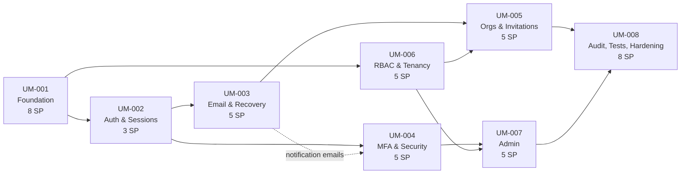

# Sprint 01 — Identity, Authentication & Organization Management

| Item | Value |
| --- | --- |
| Sprint | 01 |
| Duration | 2 weeks, 10 working days (proposed: Mon 2026-11-02 → Fri 2026-11-13) |
| Module | User Management, see [README.md](README.md) |
| Phase | **Backend only** (no UI work; journeys tested at API level) |
| Planning baseline | 2 developers (as requested) |
| **Actual team** | **1 developer (solo PFE)**. The commitment below is calculated for this case. |
| Backlog | 8 tickets, **44 story points** |
| Git workflow | [GIT-STRATEGY.md](../GIT-STRATEGY.md) |

---

## 1. Sprint goal

> **Deliver an integrated, secure first version of the REDOVA User Management backend.**

The goal covers the **whole module**. It fits in about 1.5 sprints with two developers, and does not fit in one two-week sprint for one developer (see §3). This document therefore states:

- the **full backlog** (8 tickets, dependency-ordered, estimated);
- the **commitment for the 2-developer baseline** requested by the planning brief;
- the **actual commitment for the solo developer**, plus an honest forecast of how many sprints the whole module needs.

**Solo Sprint 01 goal (committed):**
> *"The REDOVA monorepo runs locally with PostgreSQL and Redis. Better Auth is mounted in NestJS with all four plugins and the final role model. The database schema, audit trail, API conventions (`{ data, meta, error }`, cursors, error codes) and Git workflow are in place and covered by tests. Users can sign up, sign in, sign out and manage their sessions through the API. Stretch: role-escalation rules and tenant-isolation guards."*

---

## 2. Backlog

| Order | Ticket | Title | Priority | SP | Depends on |
| :-: | --- | --- | :-: | :-: | --- |
| 1 | [UM-001](tickets/UM-001-auth-foundation.md) | Better Auth Foundation & Database Integration | P0 | 8 | — |
| 2 | [UM-002](tickets/UM-002-authentication-sessions.md) | Registration, Login & Session Management | P0 | 3 | UM-001 |
| 3 | [UM-006](tickets/UM-006-rbac-multitenancy.md) | RBAC & Multi-Tenant Authorization | P0 | 5 | UM-001 |
| 4 | [UM-003](tickets/UM-003-email-verification-recovery.md) | Email Verification & Password Recovery | P0 | 5 | UM-002 |
| 5 | [UM-005](tickets/UM-005-organizations-invitations.md) | Organizations, Members & Invitations | P0 | 5 | UM-003, UM-006 |
| 6 | [UM-004](tickets/UM-004-mfa-security.md) | MFA TOTP & Account Security | P0 | 5 | UM-002 (UM-003 for notification emails) |
| 7 | [UM-007](tickets/UM-007-admin-management.md) | Admin User Management | P1 | 5 | UM-004, UM-006 |
| 8 | [UM-008](tickets/UM-008-security-testing.md) | Security Audit, Integration Tests & Hardening | P0 | 8 | UM-005, UM-007 |
| | | **Total** | | **44** | |

### 2.1 Dependency graph and execution order

**Critical path:** UM-001 → UM-002 → UM-003 → UM-005 → UM-008 (29 SP).

**Execution-order rationale:**

- Ticket IDs are stable identifiers, not the execution order.
- **UM-006 runs before UM-005.** UM-006 contains the organization role-escalation rules (an `ORG_ADMIN` must not be able to grant `ORG_ADMIN`). If UM-005 shipped first, organization role management would exist without these rules. UM-006 needs only UM-001: its tests create organizations through `auth.api.*`.
- **UM-004 waits for UM-002** (sign-in flow). It only *soft-depends* on UM-003, for the security-notification emails. Those emails can be wired last within UM-004.
- **UM-007 needs UM-004**, because MFA is mandatory for `PLATFORM_ADMIN`, and **UM-006**, for the guards.
- **UM-008 closes the module.** It provides the audit read APIs, the cross-cutting security suite, hardening, and the traceability matrix.

### 2.2 Estimation calibration

- Fibonacci story points. Calibration: **1 SP ≈ ½ ideal developer-day**, including tests and documentation updates.
- Focus factor **0.8** (meetings with the supervisor, PFE report writing, environment issues).
- Capacity per developer per sprint: 10 days × 0.8 = 8 ideal days ≈ **16 SP**.
- UM-001 (8 SP) carries most of the technical uncertainty: monorepo migration, ESM-only `better-auth` with NestJS, and the Prisma 7 configuration model. Its first task is a timeboxed spike.
- Sprint 01 has no historical velocity, so the solo commitment is kept at about 70% of capacity. **Re-forecast after Sprint 01 using the actual completed SP.**

---

## 3. Capacity and commitment

### 3.1 Baseline scenario — 2 developers (requested planning baseline)

Capacity ≈ **32 SP**.

| | Tickets | SP |
| --- | --- | :-: |
| **Committed (P0)** | UM-001, UM-002, UM-006, UM-003, UM-005 | **26** |
| **Stretch** | UM-004 | 5 |
| **Next sprint** | UM-004 (if not done), UM-007, UM-008 | 13–18 |

Work split (UM-001 blocks everything, so the first days are spent pairing on it):

| Days | Dev A | Dev B |
| --- | --- | --- |
| 1–4 | UM-001: spike, `packages/db`, `packages/auth` | UM-001: monorepo migration, docker, Git tooling, `packages/contracts`, NestJS integration |
| 5–6 | UM-002 | UM-006: core policies, hooks, guards, contract test kit |
| 7–8 | UM-003: queue, worker, templates, callbacks | UM-006 tests, then UM-005 hooks and audit wiring |
| 9–10 | UM-003 API journeys; stretch UM-004 | UM-005 tests and API journeys |

**Verdict:** with 2 developers the backend module needs about **1.5 sprints**.

### 3.2 Actual scenario — 1 developer (solo PFE)

Capacity ≈ **16 SP**.

| | Tickets | SP |
| --- | --- | :-: |
| **Committed (P0)** | UM-001, UM-002 | **11** |
| **Stretch** | UM-006 | 5 |

Proposed day plan:

| Day | Work | Checkpoint |
| :-: | --- | --- |
| 1 | Sprint planning (1 h). **Spike (timebox 1 day):** NestJS + `better-auth` (ESM-only) + `@thallesp/nestjs-better-auth` + Prisma 7 `adapter-pg` minimal boot. | Spike result recorded in UM-001 |
| 2 | Monorepo migration (`apps/server`, `apps/web` moved unchanged), root tooling, docker compose, Git tooling (PR template, commitlint, hooks) | `pnpm install && turbo build` green |
| 3 | `packages/contracts`, `packages/db` (Better Auth schema generation, REDOVA additions, `audit_event` + trigger) | Migrations apply on empty DB |
| 4 | `packages/auth` (`createAuth`, plugins, access control, Redis rate-limit `consume`) | `/api/auth/ok` reachable |
| 5 | `apps/server` integration (envelope, exception filter, logger, helmet, env, health, OpenAPI) | **Mid-sprint review:** burn-down vs plan; drop stretch if behind |
| 6 | Vitest migration, CI workflow (incl. `git-hygiene`), UM-001 tests | CI green |
| 7 | UM-001 remaining tests, DoD checklist | **UM-001 Done** |
| 8 | UM-002: audit hooks, test factories, integration tests | **UM-002 Done** |
| 9 | Stretch: UM-006 | |
| 10 | Buffer, sprint review/demo with supervisor (OpenAPI + test run), retrospective, tag `v0.1.0`, **re-forecast** | |

### 3.3 Solo forecast for the whole module

| Sprint | Committed | SP | Stretch |
| :-: | --- | :-: | --- |
| 01 | UM-001, UM-002 | 11 | UM-006 |
| 02 | UM-006, UM-003, UM-005 (UM-006 and UM-005 land together, see §2.1) | 15 | — |
| 03 | UM-004, UM-007 | 10 | UM-008 |
| 04 (≈ ½) | UM-008 (if not finished) | ≤ 8 | Buffer, PFE report |

**Honest conclusion:** the backend module needs about **3 to 3.5 sprints (6–7 weeks) for one developer**.

**Lean-scope option (needs confirmation, SD-1):** postponing the items below saves about 5 SP (≈ 3 sprints flat), while keeping every P0 security requirement:

| Item deferred | Ticket |
| --- | --- |
| Per-account sign-in throttle (per-IP rate limit kept) | UM-008 |
| `existing-account` email; production provider adapter until deployment is planned | UM-003 |
| Trusted-device option; MFA-reset operator CLI (runbook only) | UM-004 |

---

## 4. Risks

| ID | Risk | Probability | Impact | Mitigation |
| --- | --- | :-: | :-: | --- |
| RK-1 | `better-auth` is ESM-only, and NestJS compiles to CommonJS by default | Medium | High | Day-1 spike. Node ≥ 22.12 (`require(esm)`, local Node is 24.18) or an ESM NestJS build; `@thallesp/nestjs-better-auth` ships both formats. |
| RK-2 | Prisma 7 configuration changes (`prisma.config.ts`, mandatory driver adapter, explicit client output) | Medium | Medium | Same spike; follow the Prisma 7 docs; keep the client in `packages/db`. |
| RK-3 | A Better Auth hook behaves differently from the documented assumption (e.g. which hooks fire on `leave`) | Medium | Medium | Every hook-based behavior has an integration test. On a mismatch, adjust the wiring and update README §17.4. |
| RK-4 | Gmail SMTP throttles or blocks development emails | Low | Low | Mailpit is available in dev too (`docker compose --profile test`). |
| RK-5 | HIBP API unavailable during a demo | Low | Medium | Fail-closed by design. For demos, show the documented error; never disable it in production. |
| RK-6 | Solo capacity is overestimated (PFE report, exams) | High | High | 70% commitment, mid-sprint checkpoint on day 5, drop stretch first, re-forecast at sprint end, consider the lean scope (SD-1). |
| RK-7 | Deleting the nested `.git` folders during migration loses history | Low | Low | `backend/` has no commits and `frontend/` has only the scaffold commit. Archive both folders before removal (UM-001 task). |

---

## 5. Definition of Ready (per ticket)

A ticket can be started when:

- [ ] Its dependencies are **Done** (not merely "in progress").
- [ ] Open decisions it relies on (§6) are answered or have an agreed default.
- [ ] Acceptance criteria are understood and testable as written.
- [ ] Its GitHub issue exists and the branch name is chosen ([GIT-STRATEGY §3](../GIT-STRATEGY.md#3-branch-naming)).
- [ ] Required local infrastructure (PostgreSQL, Redis, Mailpit where relevant) runs.

---

## 6. Open decisions affecting the sprint

| ID | Decision | Default if not answered | Affects |
| --- | --- | --- | --- |
| SD-1 | Full scope (≈ 3–3.5 solo sprints) or lean scope (≈ 3)? | Full scope; re-decide at the Sprint 01 review | Forecast |
| D-09 | `freshAge` = 1 h (also applies to native "list sessions") | Adopted | UM-002, UM-004, UM-007 |
| D-11 | Production email provider | SMTP-only until deployment is planned | UM-003 |
| D-12 | Vitest replaces the scaffolded Jest | Adopted | UM-001 |
| D-13 | `PLATFORM_ADMIN` has no implicit tenant-data access | Adopted | UM-006, UM-007 |
| D-18 | Any organization member can list pending invitations (native behavior) | Adopted | UM-005, UM-006 |

The full decision log is in [README Appendix B](README.md#appendix-b--decision-log).

---

## 7. Sprint ceremonies (solo adaptation)

| Ceremony | When | Output |
| --- | --- | --- |
| Sprint planning | Day 1, 1 h | Confirmed commitment and stretch; GitHub issues created |
| Daily check-in | Every day, 5 min, written | Yesterday / today / blockers in a sprint log |
| Mid-sprint checkpoint | Day 5 | Go/no-go on stretch; scope cut if behind |
| Sprint review | Day 10 | Demo to the PFE supervisor (OpenAPI docs, test run, audit trigger); accepted tickets; tag `v0.1.0` |
| Retrospective | Day 10 | One process improvement for Sprint 02 |
| Re-forecast | Day 10 | Actual velocity → update §3.3 |

---

## 8. Final sprint checklist

### Before the sprint starts

- [ ] Sprint goal and commitment (§1, §3.2) accepted by the project owner/supervisor
- [ ] Decisions SD-1, D-09, D-11, D-12, D-13, D-18 answered or defaults accepted
- [ ] GitHub repository created; `main` protection configured per [GIT-STRATEGY §8](../GIT-STRATEGY.md#8-main-branch-protection-github-settings); one issue per ticket (UM-001 … UM-008)
- [ ] Docker Desktop, Node ≥ 22.12, pnpm installed; Google App Password created for dev email (needed in UM-003)
- [ ] `backend/` and `frontend/` folders archived before the monorepo migration

### During the sprint

- [x] Day-1 spike outcome recorded in UM-001 (go / adjust)
- [ ] Mid-sprint checkpoint held on day 5; stretch kept or dropped explicitly
- [ ] Every change delivered through a PR following GIT-STRATEGY (branch name, Conventional Commits, template filled, no AI attribution)
- [ ] Each merged PR keeps `pnpm turbo run lint typecheck test` green

### Committed scope (solo)

- [ ] UM-001 meets every acceptance criterion and its Definition of Done
- [ ] UM-002 meets every acceptance criterion and its Definition of Done
- [ ] `docker compose up` + `pnpm dev` starts the server (3001); `GET /api/v1/health` returns the envelope with `db: up`, `redis: up`
- [ ] Better Auth schema committed; Better Auth CLI diff is empty; `audit_event` is append-only (trigger tested)
- [ ] Better Auth admin HTTP paths return 404; rate limiting uses Redis
- [ ] Commit-msg hook and CI `git-hygiene` reject a `Co-authored-by:` trailer
- [ ] `.env.example` files complete; no secret committed (gitleaks clean)

### Stretch scope (solo)

- [ ] UM-006 Done: escalation rules, guards, tenant-isolation contract kit

### Sprint close

- [ ] Demo performed: health endpoint, `/api/v1/docs`, `/api/auth/reference`, sign-up → sign-in → sessions via API, audit rows, audit trigger
- [ ] README and tickets updated with anything learned (hook behavior, config changes)
- [ ] `v0.1.0` tagged on `main`; GitHub release notes generated
- [ ] Velocity recorded; §3.3 forecast updated; Sprint 02 backlog ordered
- [ ] Retrospective action item recorded
